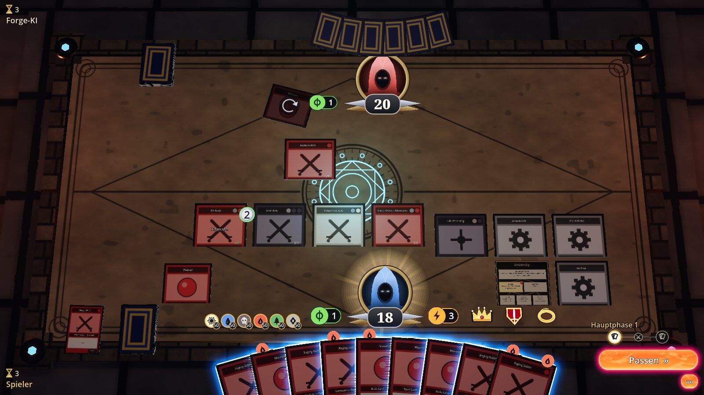
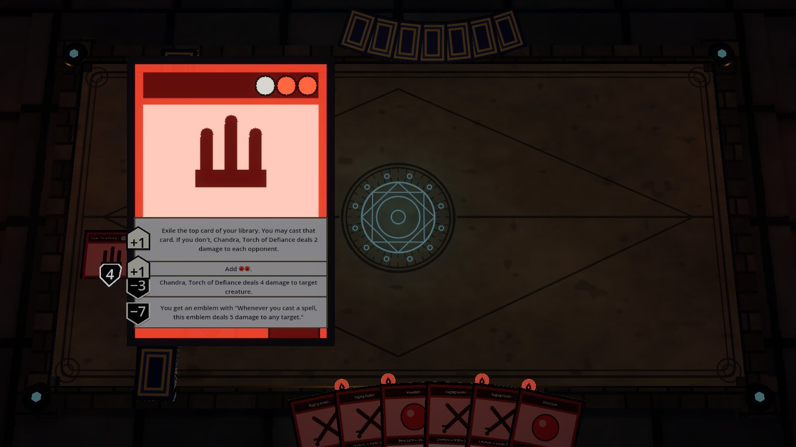
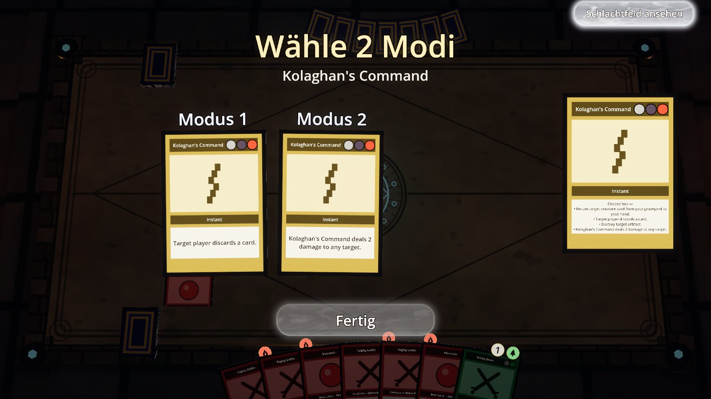
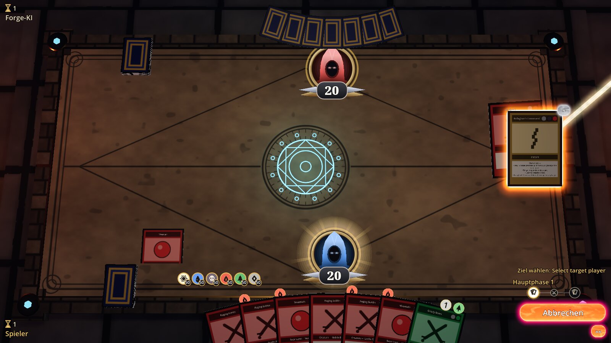
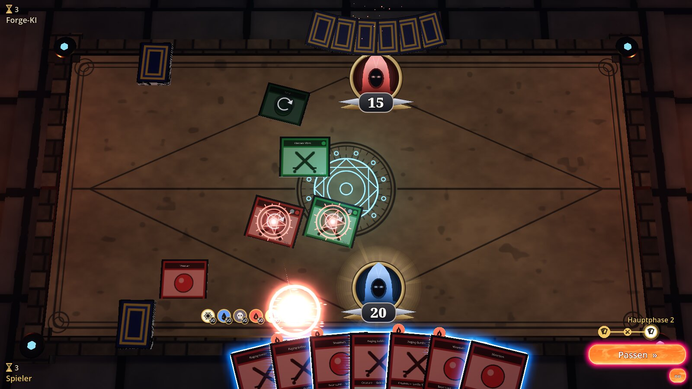
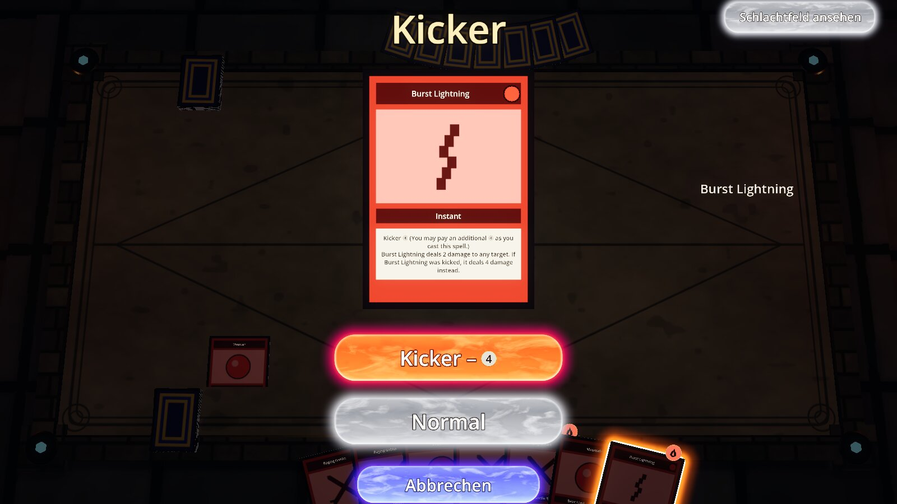
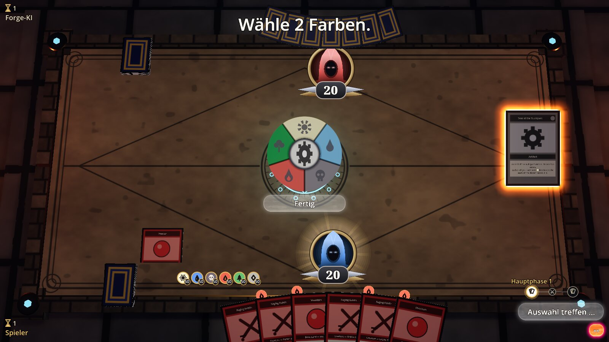

# Neo Forge 3D

**A 3D game table for the complete Magic rules engine of [Forge](https://github.com/Card-Forge/forge)** –
built with Godot 4.7 and Rust. Every decision Forge asks of a player is made right at the table;
the AI only plays your opponent. The table does not check any rules itself: it shows the engine's
state and sends your answers back to it.

The goal is a 3D table for [NeoForge](https://github.com/AdrianLopez98/NeoForge) (a JavaFX front
end for Forge): when NeoForge starts a two-player match with the 3D table enabled, this Godot UI
takes over the human seat. Until then it also runs standalone against Forge.



<sub>All images were made in "own graphics only" mode (`CLASH_FREE_ASSETS=1`): self-drawn card
frames, type symbols and mana symbols, no card images. **Every mechanic with a picture:
[docs/Mechanics.md](docs/Mechanics.md).**</sub>

## Features

- **Decide everything at the table:** drag cards from your hand onto the battlefield, choose
  targets with arrows, attackers and blockers by click, pay mana (click sources or pay
  automatically), mulligan, scry, choose cards, order triggers, modes (including Spree/Tiered
  with costs), kicker and other additional costs, a colour wheel for colours, divide damage.
- **The whole game state is visible:** the stack as a 3D pile with target arrows, graveyard and
  exile, command zone, counters as coins, attached auras and equipment, tokens, double-faced and
  face-down cards, monarch/initiative/the Ring, day/night, classes, rooms, sagas.
- **Planeswalkers as you know them:** a click opens the card large; choose loyalty abilities
  directly on the card.
- **Cards from other zones** (flashback, commander, companion, foretell …) appear to the right of
  the hand with the cost of how they can be played.
- **Two ways to Forge:** standalone (the table starts Forge as a Java process) or embedded in
  [NeoForge](https://github.com/AdrianLopez98/NeoForge), which then plays its matches (Standard,
  Pioneer, Modern, Legacy, Vintage, Pauper, Commander, Draft, Cube) on the 3D table.
- German and English.

| Planeswalker | Choosing a mode |
|---|---|
|  |  |
| **Spell on the stack with target arrow** | **Attacking** |
|  |  |
| **Kicker** | **Colour wheel** |
|  |  |

More: [all mechanics with pictures](docs/Mechanics.md).

## Repository layout

| Folder | Contents |
|---|---|
| `godot/` | Godot project (main scene `table.tscn`) |
| `rust/` | Godot extension (gdext): table, HUD, rendering |
| `rust/crates/clash-protocol/` | Protocol model `Decision`/`Choice` + JSON, no Godot dependency |
| `rust/crates/clash-forge-client/` | Connection to the bridge (Java process or host), no Godot dependency; example `autoplay` |
| `forge-bridge/` | Java bridge to Forge: facade `ClashBridge`, `TableLauncher`, Forge adapter |
| `integrations/neoforge/` | NeoForge integration: `ClashTable` + patch for NeoForge's classes |
| `docs/` | Usage and architecture ([`DOCUMENTATION.md`](docs/DOCUMENTATION.md)), every mechanic with a picture ([`Mechanics.md`](docs/Mechanics.md)), protocol ([`Forge-Protocol.md`](docs/Forge-Protocol.md)), embedding in other projects ([`Embedding.md`](docs/Embedding.md)), API reference |
| `tools/` | Scripts (docs, NeoForge sync/patch/test) |

The Forge integration can be reused without the Godot table – for your own front ends and other
Forge programs: **[docs/Embedding.md](docs/Embedding.md)**.

## Quick start

Requirements: Godot 4.7, Rust (edition 2024), Java 17+ and a Forge installation (desktop
version; a folder with `res/` and `forge-gui-desktop-*-jar-with-dependencies.jar`).

```sh
FORGE_DIR=/path/to/forge forge-bridge/build.sh   # Java bridge
cd rust && cargo build                            # Godot extension and crates
# Open Godot 4.7: godot/project.godot, F5 (FORGE_DIR must be set,
# or copy Forge to forge-bridge/forge/)
```

Detailed setup: [docs/Forge-Protocol.md](docs/Forge-Protocol.md), section "Setup". Own graphics
only (no card images, no third-party symbols): set `CLASH_FREE_ASSETS=1` or start Godot with
`-- --free-assets`.

## Contributing

Code comments and the in-engine class reference (`///` docs, `docs/API-Referenz.md`) are written
in German; the developer documentation in this README and in `docs/` is in English. Commit
messages are in English. The UI never implements rules – every rule question goes to Forge
through the protocol.

## License

**GPL-3.0**, like Forge – see [`LICENSE`](LICENSE).

Not in this repository and not covered by this license: Forge itself (program jar and card
database) and the card images, which the table reads from the local Forge installation or
downloads from Scryfall. Magic: The Gathering, card names, texts and images are property of
Wizards of the Coast; this project is not affiliated with Wizards of the Coast. The symbol files
`Assets/Mana/Mana.svg` (slightlymagic.net) and `Assets/Mana/Colorless.svg` are third-party
material and not part of the material licensed here; they are not used in "own graphics only"
mode.
